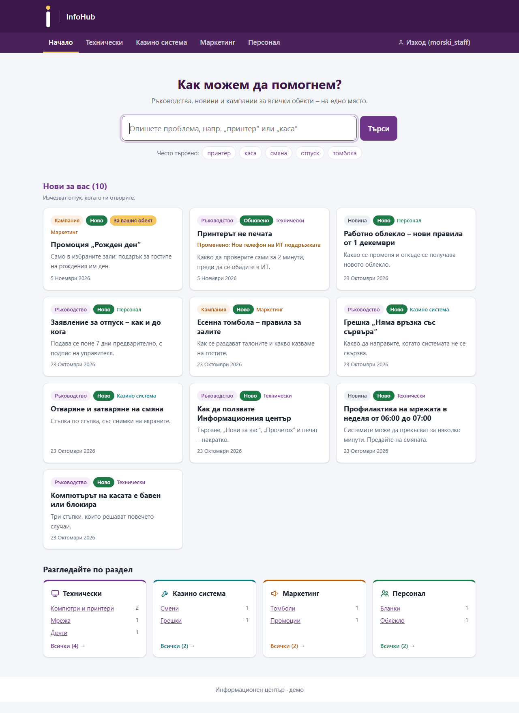
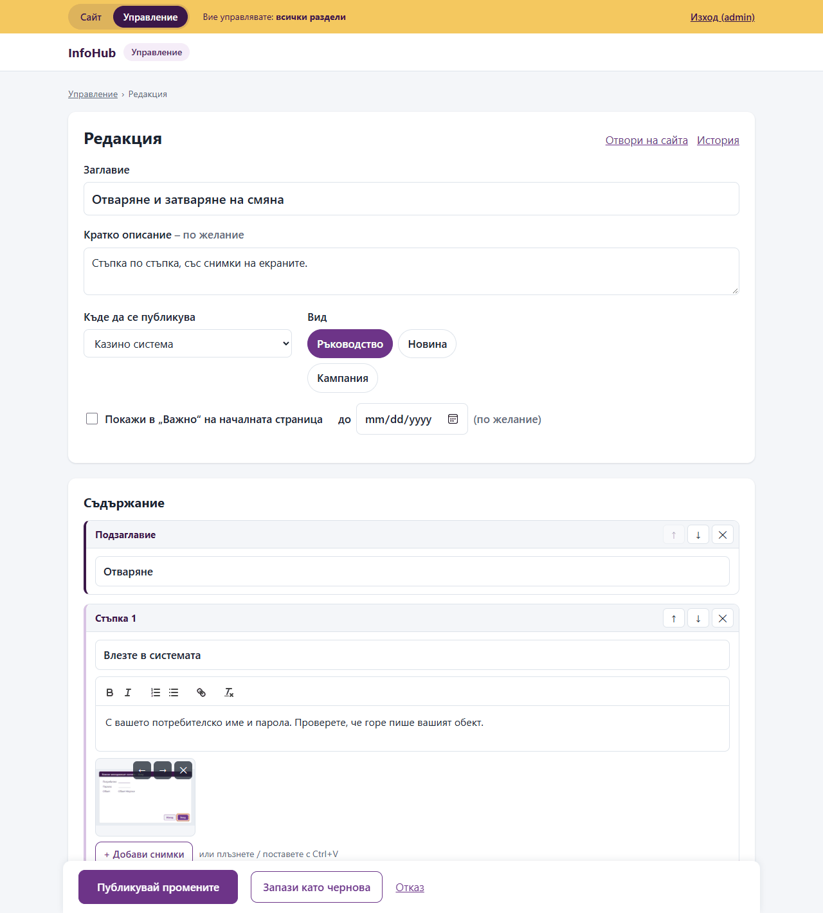
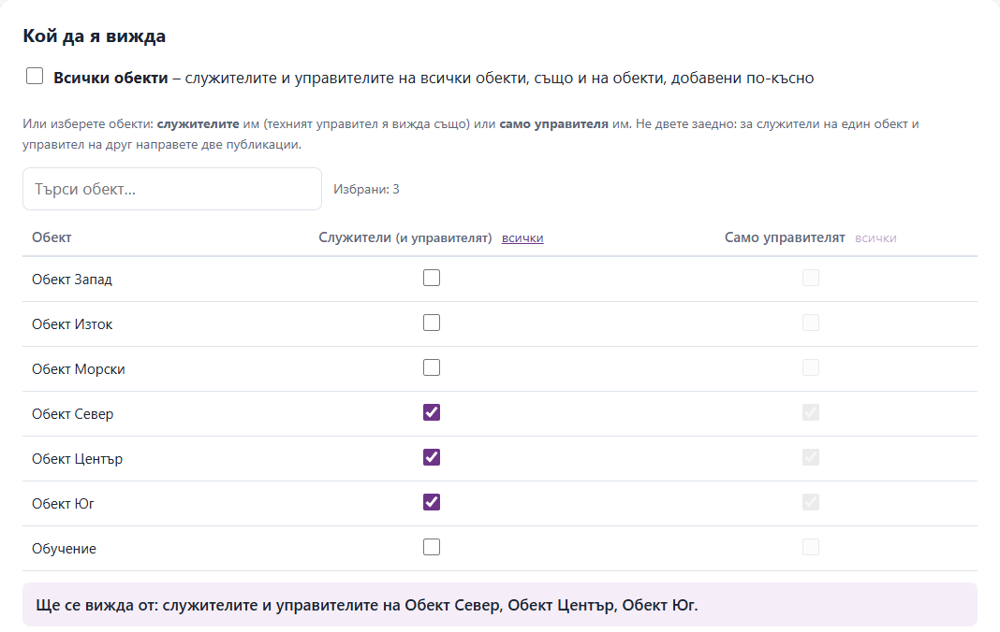
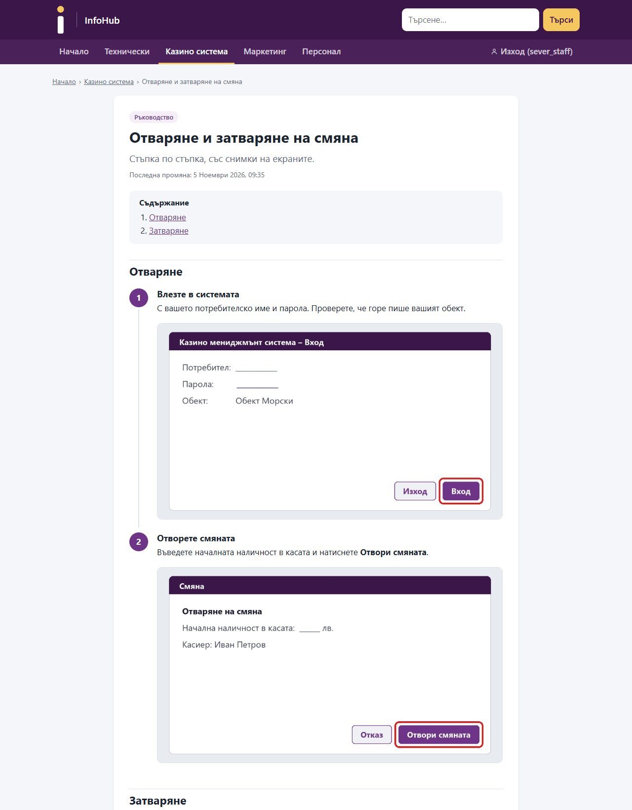
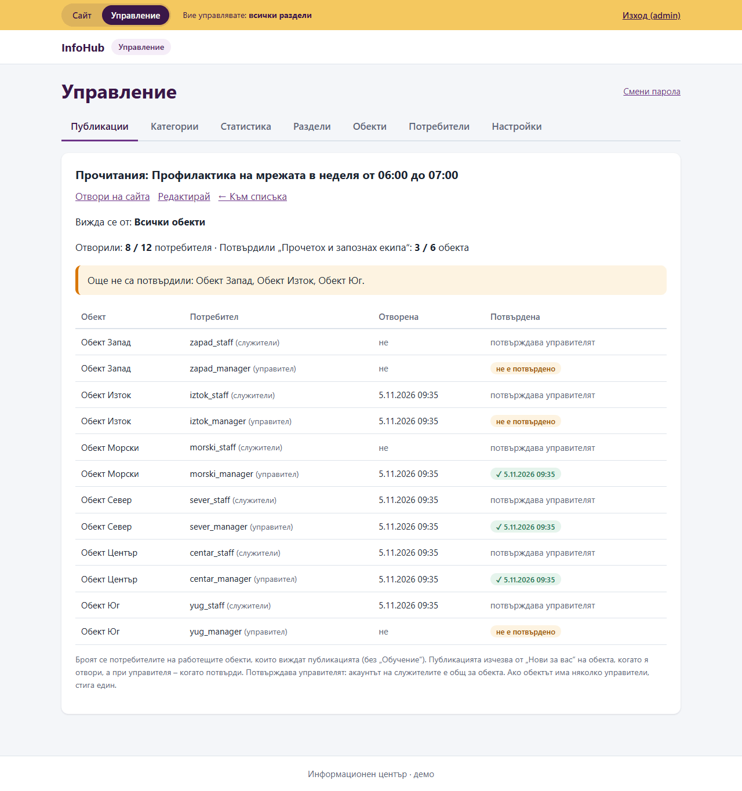
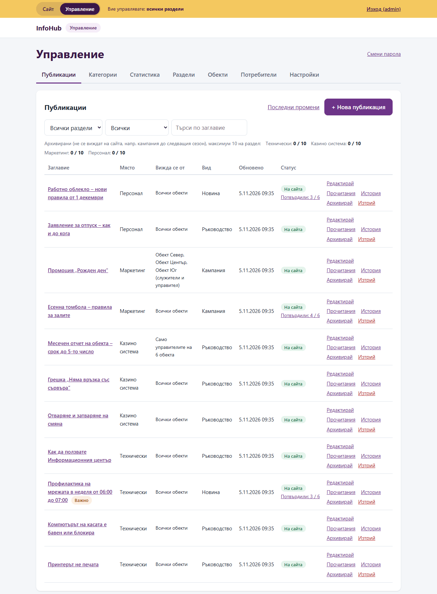
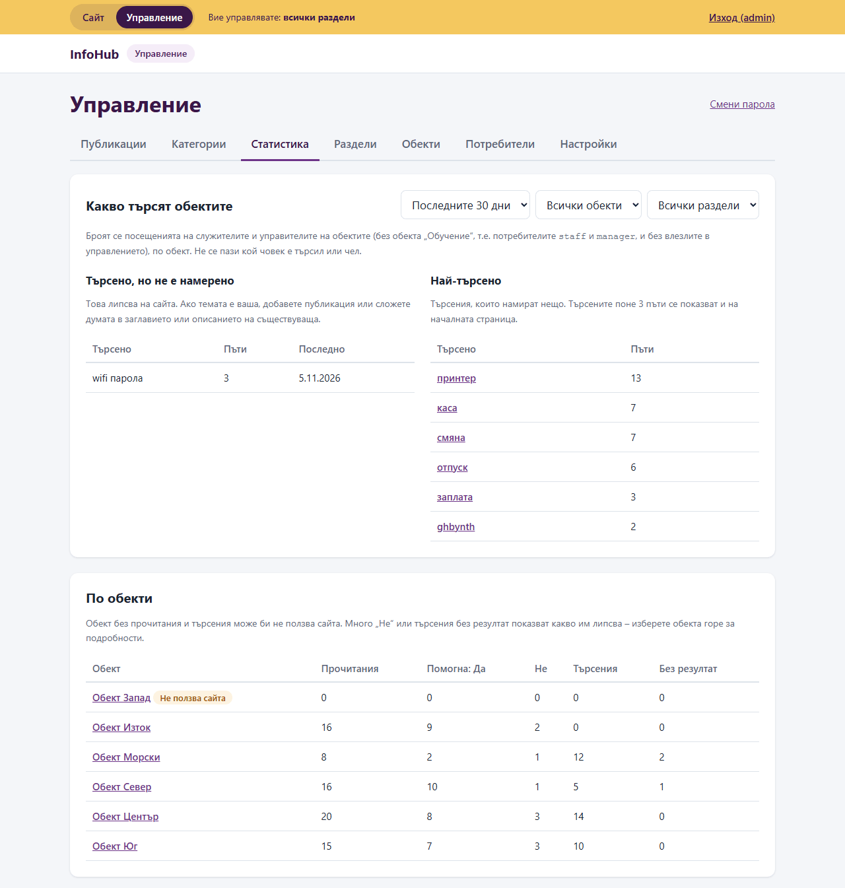
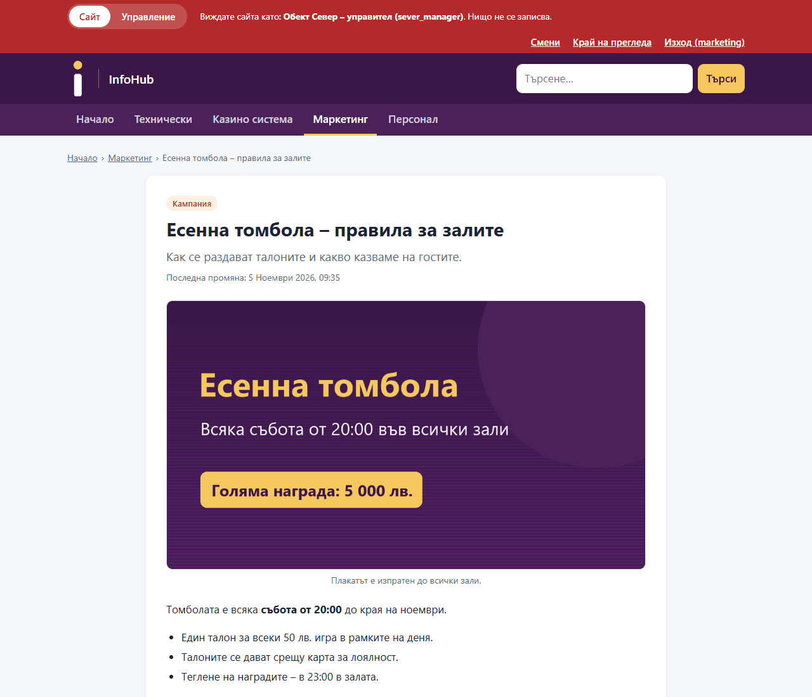
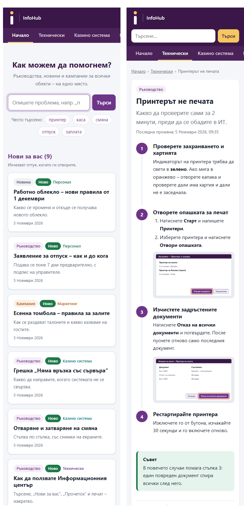

# InfoHub – an internal knowledge hub for a multi-venue company

A private website where the staff of **23 venues** find technical guides, news and campaigns, and
where each department publishes its own posts in a simple block editor. Built for a casino and
gaming operator as one central, searchable place for everything the venues need to know. Posts are targeted per venue and role, venues confirm that they have read important
rules, and the departments see per-venue statistics of what is read and what is searched for but
missing.

**Stack:** Python 3.13 · Django 6.1 · Wagtail 7.4 · Quill 2 · PostgreSQL / MariaDB / SQLite ·
Docker · nginx · Caddy (Let's Encrypt)

The interface is in Bulgarian, as it is for the people who use it. The screenshots show a demo
copy with fictional venues and content.



## What it does

**For venue staff** (read-only accounts, one per venue and role, logged in on the venue PCs for a year)
- A home page built around one search box, with each section's categories as the way in. Search finds Bulgarian word forms (принтер / принтера / принтерът), forgives the wrong keyboard layout, Latin spelling and typos ("ghbynth", "printer", "принетр" → принтер), and suggests what other venues search for most.
- **„Нови за вас“ (New for you):** every new post waits on the venue's home page until someone there opens it; important ones stay with the venue's manager until they confirm **„Прочетох и запознах екипа“ (read it and briefed the team)**, or just „Прочетох“ for a managers-only post: the staff account is shared by the venue, so the manager answers for it.
- Step-by-step guides with screenshots, videos and downloadable forms (PDF, Word, Excel and PowerPoint also shown inside the page, the Office files through a PDF copy made by LibreOffice); a print view; „Did this help? Yes / No“ feedback, where "No" asks what was missing and shows whom to contact.
- Venue managers additionally see posts meant only for managers. Nothing else is visible: a post or file outside a user's audience simply does not exist for them (404).

**For the departments** (editors of IT, the casino management system, Marketing, HR)
- A block editor in the browser: numbered steps with several pictures and files each, text, subheadings, images, videos, notes and files. Screenshots can be pasted straight from the clipboard (Ctrl+V) or dragged in; every file uploads on its own with a progress bar.
- **Who sees it:** all venues, the staff of chosen venues (their managers included), or only the managers of chosen venues, picked in one table with a live summary.
- A gold bar with two tabs, **„Сайт | Управление“**, always shows editors whether they are looking at the site or at the publishing panel; the panel has its own header.
- **Important change:** an edit can be marked important, so the post returns to every venue's „Нови за вас“ as „Обновено“ with a one-line note of what changed, optionally asking the managers to confirm again; a typo fix stays quiet.
- Drafts with a preview, an autosaved copy in the browser offered back after a crash, **„Виж като обект“** (the site exactly as a chosen venue account sees it, under a red bar, recording nothing), archive instead of delete, and **„Прочитания“**: which venue has opened and confirmed a post, and who has not yet.
- **History** of every post: who saved, published, archived or deleted what, and any earlier version can be previewed and brought back.
- Statistics per venue: views, helpful / not helpful with the staff's reasons, searches with no result (= what is missing), and venues that do not use the site.

**For the administrator**
- Sections (departments), venues, every account and the site settings (name, logo, footer) in one panel; ↑ ↓ ordering of the sections.
- A printable sheet with new random passwords for every venue (one venue per page).
- Stopping a venue logs out all its PCs at once; nightly cleanup of unused uploads and old data.

| Writing a post | Choosing who sees it |
|---|---|
|  |  |
| **A guide as a venue sees it** | **Who has read it** |
|  |  |
| **The publishing panel** | **Statistics per venue** |
|  |  |

**„Виж като обект“:** an editor sees a post exactly as one venue's manager does; nothing is recorded and every button is off.



<p align="center"></p>

## Engineering highlights

- **One visibility rule for everything.** `guides/audience.py` builds the queryset filter for a venue and role; lists, search, guide pages, feedback, statistics, „frequent searches“ and **media files** all use it, so a manager-only post can't leak through a side door. The audience is stored as one mode plus a venue list, which makes invalid mixes impossible in the data, not only in the UI.
- **Protected media.** Every picture, video and document is served only after a login and audience check, with HTTP range requests for video seeking; behind nginx the file transfer is handed off via `X-Accel-Redirect`.
- **Safe rich text.** The editor's HTML goes through Wagtail's own whitelist converter before it is stored as StreamField blocks; hostile input (`<script>`, `onerror`, `javascript:` links) is covered by tests on every page that shows it.
- **Viewing as a venue without its password.** A middleware swaps in the chosen venue account for site pages only, so every list, search, label and file goes through the same visibility rule; anything that would write (views, votes, read receipts, any POST) is refused while looking, and the panel, previews and file thumbnails keep the editor's own rights. The whole visibility test suite is run a second time through this path.
- **Security hardening.** Login required everywhere (`LoginRequiredMiddleware`), a login throttle that counts the real visitor address behind the proxy, read-only accounts that cannot change or reset passwords, no public admin login (Wagtail's admin closed, one back office), a Content-Security-Policy that runs only the site's own scripts, safe redirects, `noindex`, pages not kept by the browser after logout, forms sent only once, a button pressed after the session ended returns to its page after login, secure cookies and HSTS in production, dependencies checked with `pip-audit`.
- **Bulgarian-aware search and checks.** SQLite folds the case of Latin letters only, so search uses a stored lower-case text and name checks compare in Python (`casefold`).
- **Publishing on top of Wagtail revisions.** Drafts, previews and „archive“ are Wagtail revisions and publish states; the panel keeps the list view right for drafts and archived posts.
- **Portable data.** `export_site` / `import_site` move the whole site (accounts with their password hashes, posts, history, statistics) between SQLite, PostgreSQL and MariaDB; tested end to end with a visibility audit on the copy.
- **Deployable anywhere.** Docker Compose with gunicorn, PostgreSQL and nginx; an HTTPS variant with Caddy and automatic Let's Encrypt certificates; notes for shared cPanel hosting with MariaDB.

## Quality

```
python manage.py test
```

- **322 tests** on a separate test database: access per role, visibility per venue and role (also through „Виж като обект“), the editor and uploads, every error message, the panel, settings, the security policy, moving a site, and edge cases such as hostile input, open redirects, odd search input and unknown ids.
- **178 browser checks** of the JavaScript (editor and its autosave, audience picker, user form, login page, site scripts) in jsdom on freshly rendered pages, run from the same command.
- **99 % line coverage**; `pyflakes` and dead-code scans clean; no known vulnerabilities in the dependencies; a read-only `check_site` command audits a live database (integrity, files on disk, and every venue account × post against an independent copy of the rule).
- Every release is also clicked through in a real browser (Playwright + Edge) on a copy of the data: about 90 pages per role with no script errors or policy blocks.

Details: [tests/README.md](tests/README.md).

## Run it locally

Requires Python 3.13+ (Node.js only for the JavaScript tests).

```bash
python -m venv .venv
.venv\Scripts\activate            # Windows; on Linux/macOS: source .venv/bin/activate
pip install -r requirements-dev.txt
python manage.py migrate
python manage.py setup_infohub      # home page, the four sections, editor accounts, a training venue
python manage.py createsuperuser
python manage.py runserver
```

Open http://localhost:8000/login/. The publishing panel is at `/manage/`. Add venues in
`/manage/` → Обекти and their accounts in Потребители. For the JavaScript tests, run
`npm install` once in `tests/js/`.

## Documentation

| | |
|---|---|
| [docs/DEVELOPMENT.md](docs/DEVELOPMENT.md) | Roles, the visibility rule, content model, project layout |
| [DEPLOY.md](DEPLOY.md) | Docker, HTTPS on a VM (e.g. Oracle Cloud free tier), shared hosting with MariaDB, moving a site |
| [EDITORS.md](EDITORS.md) | The user guide for editors and the administrator (Bulgarian) |
| [tests/README.md](tests/README.md) | What the tests cover and how to run them |

## License

No licence is granted: the code is published for viewing as a portfolio project. All rights
reserved.
