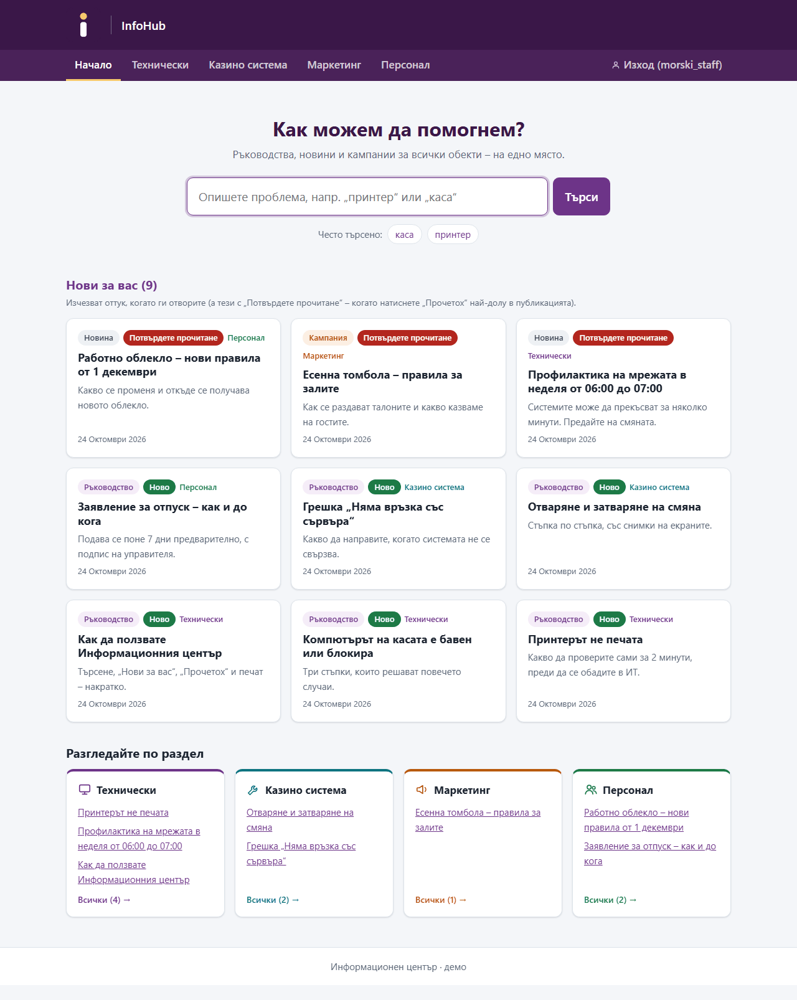
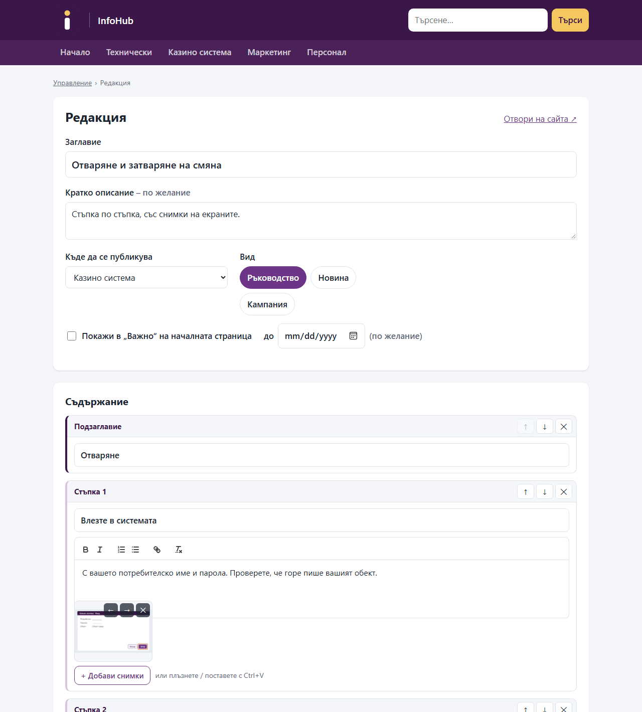
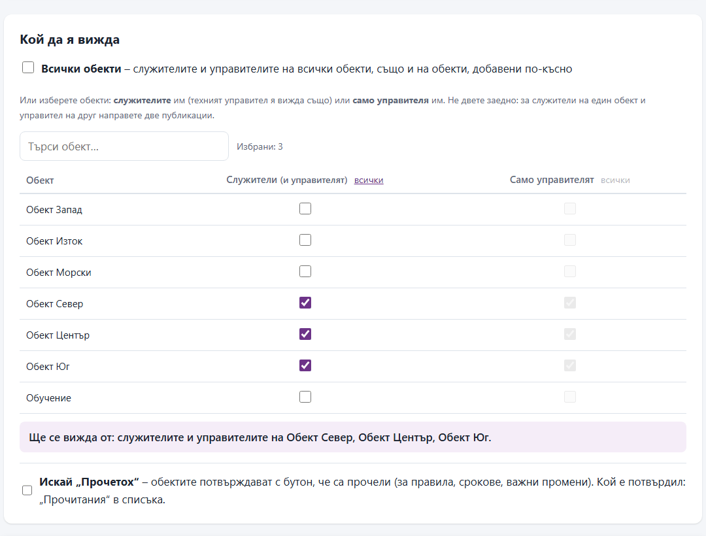
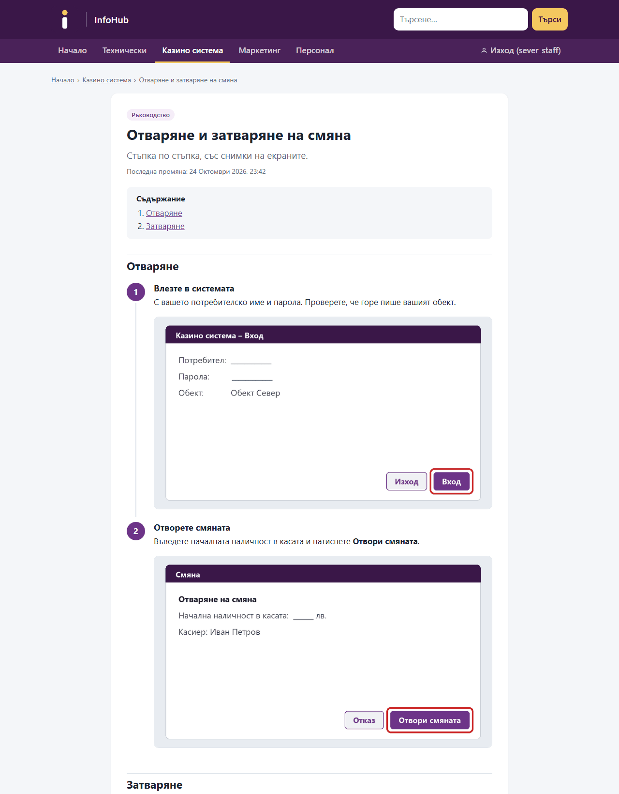
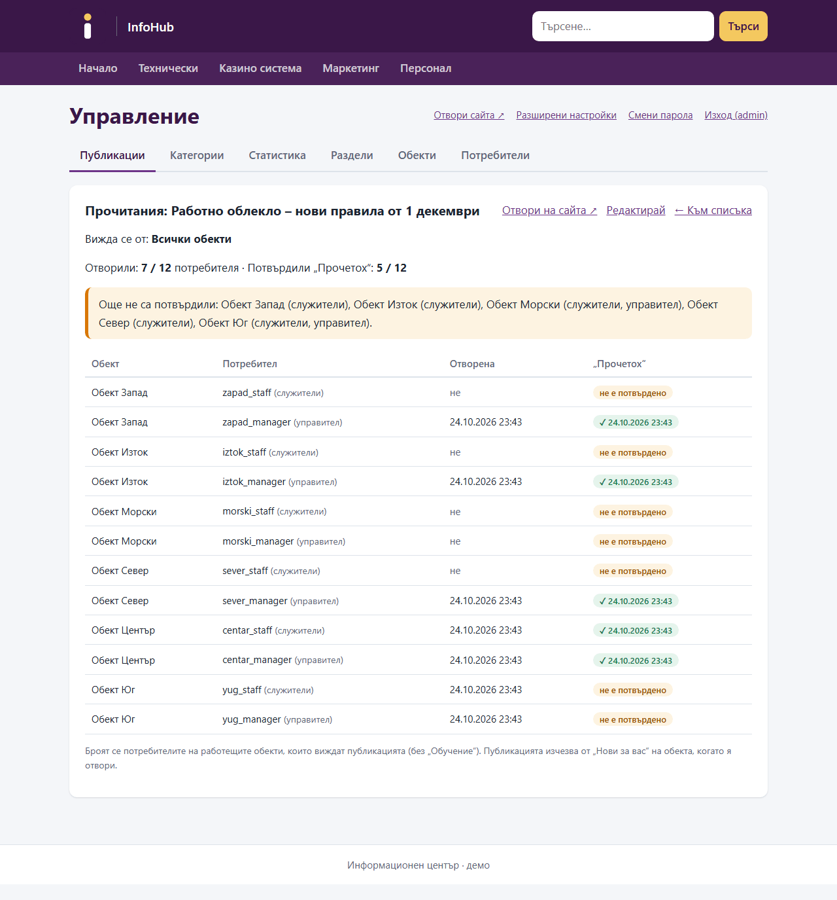
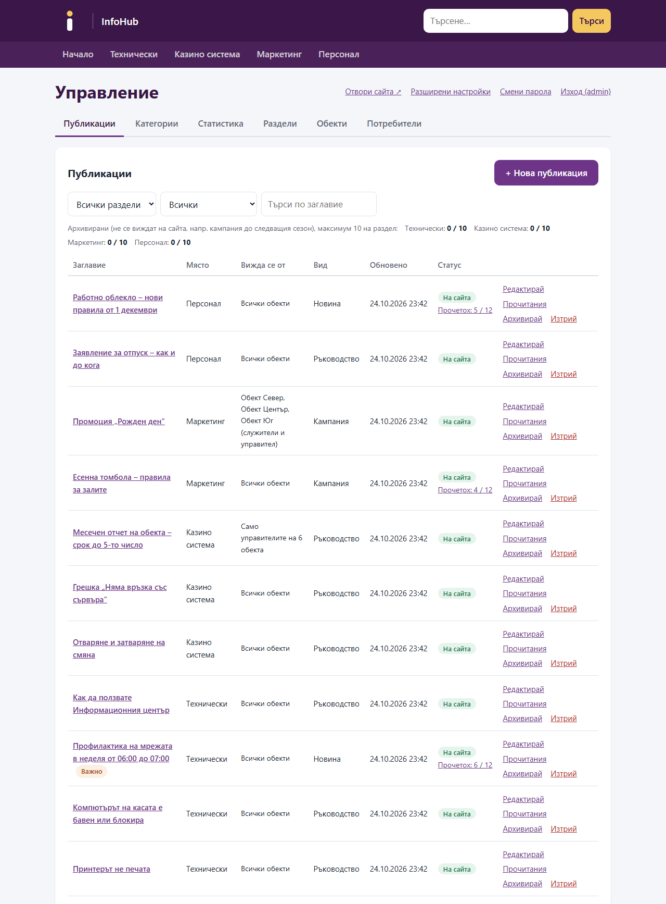
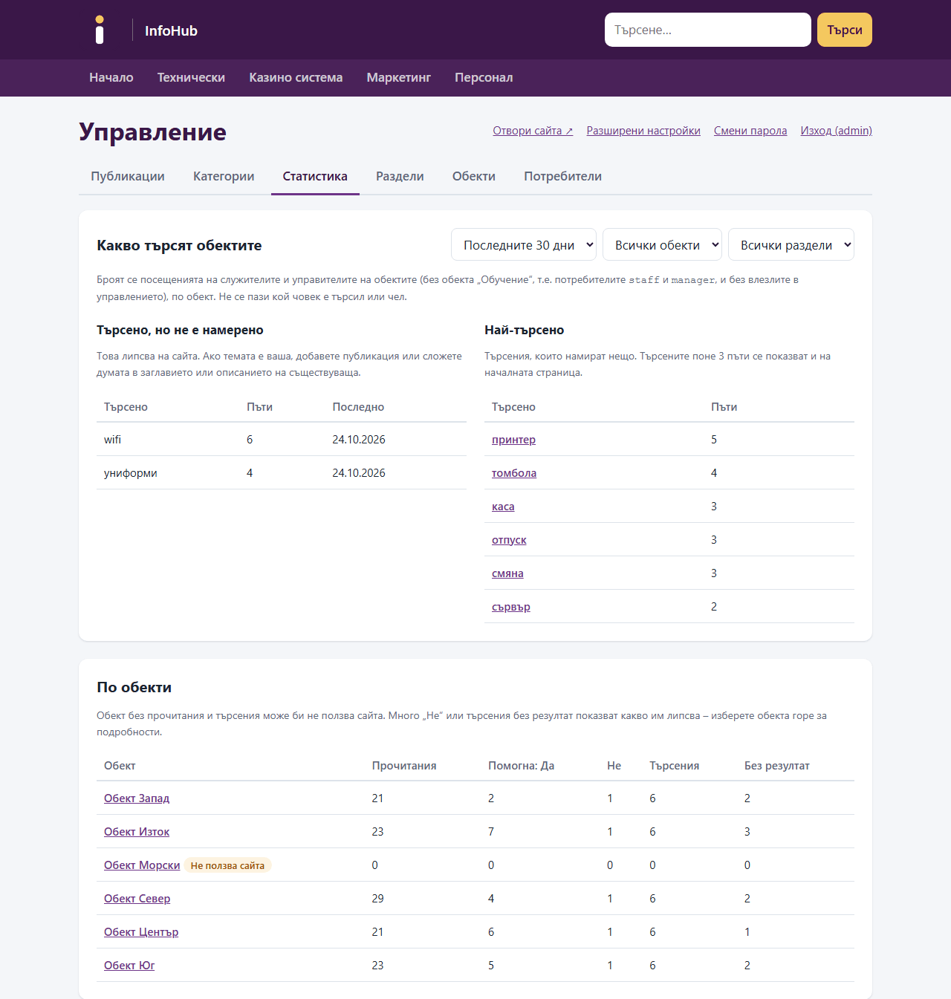
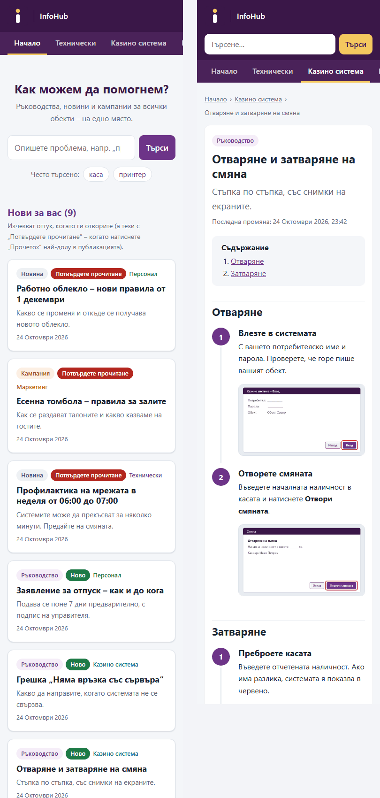

# InfoHub – an internal knowledge hub for a multi-venue company

A private website where the staff of **23 venues** find technical guides, news and campaigns, and
where each department publishes its own posts in a simple block editor. Built for a casino and
gaming operator as one central, searchable place for everything the venues need to know. Posts are targeted per venue and role, venues confirm that they have read important
rules, and the departments see per-venue statistics of what is read and what is searched for but
missing.

**Stack:** Python 3.13 · Django 6.1 · Wagtail 7.4 · Quill 2 · PostgreSQL / MariaDB / SQLite ·
Docker · nginx · Caddy (Let's Encrypt)

The interface is in Bulgarian, as it is for the people who use it. The screenshots show a demo
copy with fictional venues and content.



## What it does

**For venue staff** (read-only accounts, one per venue and role, logged in on the venue PCs for a year)
- A home page built around one search box. Search finds Bulgarian word forms (принтер / принтера / принтерът) and suggests what other venues search for most.
- **„Нови за вас“ (New for you):** every new post waits on the venue's home page until someone there opens it; important ones until they confirm **„Прочетох“ (I have read it)**.
- Step-by-step guides with screenshots, videos and downloadable forms; a print view; „Did this help? Yes / No“ feedback.
- Venue managers additionally see posts meant only for managers. Nothing else is visible: a post or file outside a user's audience simply does not exist for them (404).

**For the departments** (editors of IT, the casino management system, Marketing, HR)
- A block editor in the browser: numbered steps with several pictures each, text, subheadings, images, videos, notes and files. Screenshots can be pasted straight from the clipboard (Ctrl+V) or dragged in; every file uploads on its own with a progress bar.
- **Who sees it:** all venues, the staff of chosen venues (their managers included), or only the managers of chosen venues, picked in one table with a live summary.
- Drafts with a preview, archive instead of delete, and **„Прочитания“**: which venue has opened and confirmed a post, and who has not yet.
- Statistics per venue: views, helpful / not helpful, searches with no result (= what is missing), and venues that do not use the site.

**For the administrator**
- Sections (departments), venues and every account in one panel; ↑ ↓ ordering of the sections.
- A printable sheet with new random passwords for every venue (one venue per page).
- Stopping a venue logs out all its PCs at once; nightly cleanup of unused uploads and old data.

| Writing a post | Choosing who sees it |
|---|---|
|  |  |
| **A guide as a venue sees it** | **Who has read it** |
|  |  |
| **The publishing panel** | **Statistics per venue** |
|  |  |

<p align="center"></p>

## Engineering highlights

- **One visibility rule for everything.** `guides/audience.py` builds the queryset filter for a venue and role; lists, search, guide pages, feedback, statistics, „frequent searches“ and **media files** all use it, so a manager-only post can't leak through a side door. The audience is stored as one mode plus a venue list, which makes invalid mixes impossible in the data, not only in the UI.
- **Protected media.** Every picture, video and document is served only after a login and audience check, with HTTP range requests for video seeking; behind nginx the file transfer is handed off via `X-Accel-Redirect`.
- **Safe rich text.** The editor's HTML goes through Wagtail's own whitelist converter before it is stored as StreamField blocks; hostile input (`<script>`, `onerror`, `javascript:` links) is covered by tests on every page that shows it.
- **Security hardening.** Login required everywhere (`LoginRequiredMiddleware`), a login throttle that counts the real visitor address behind the proxy, read-only accounts that cannot change or reset passwords, no public admin login, safe redirects, `noindex`, secure cookies and HSTS in production, dependencies checked with `pip-audit`.
- **Bulgarian-aware search and checks.** SQLite folds the case of Latin letters only, so search uses a stored lower-case text and name checks compare in Python (`casefold`).
- **Publishing on top of Wagtail revisions.** Drafts, previews and „archive“ are Wagtail revisions and publish states; the panel keeps the list view right for drafts and archived posts.
- **Portable data.** `export_site` / `import_site` move the whole site (accounts with their password hashes, posts, history, statistics) between SQLite, PostgreSQL and MariaDB; tested end to end with a visibility audit on the copy.
- **Deployable anywhere.** Docker Compose with gunicorn, PostgreSQL and nginx; an HTTPS variant with Caddy and automatic Let's Encrypt certificates; notes for shared cPanel hosting with MariaDB.

## Quality

```
python manage.py test
```

- **162 tests** on a separate test database: access per role, visibility per venue and role, the editor and uploads, every error message, the panel, settings, moving a site, and edge cases such as hostile input, open redirects, odd search input and unknown ids.
- **92 browser checks** of the JavaScript (editor, audience picker, user form) in jsdom on freshly rendered pages, run from the same command.
- **98 % line coverage**; `pyflakes` and dead-code scans clean; no known vulnerabilities in the dependencies.

Details: [tests/README.md](tests/README.md).

## Run it locally

Requires Python 3.13+ (Node.js only for the JavaScript tests).

```bash
python -m venv .venv
.venv\Scripts\activate            # Windows; on Linux/macOS: source .venv/bin/activate
pip install -r requirements-dev.txt
python manage.py migrate
python manage.py setup_infohub      # home page, the four sections, editor accounts, a training venue
python manage.py createsuperuser
python manage.py runserver
```

Open http://localhost:8000/login/. The publishing panel is at `/manage/`. Add venues in
`/manage/` → Обекти and their accounts in Потребители. For the JavaScript tests, run
`npm install` once in `tests/js/`.

## Documentation

| | |
|---|---|
| [docs/DEVELOPMENT.md](docs/DEVELOPMENT.md) | Roles, the visibility rule, content model, project layout |
| [DEPLOY.md](DEPLOY.md) | Docker, HTTPS on a VM (e.g. Oracle Cloud free tier), shared hosting with MariaDB, moving a site |
| [EDITORS.md](EDITORS.md) | The user guide for editors and the administrator (Bulgarian) |
| [tests/README.md](tests/README.md) | What the tests cover and how to run them |

## License

No licence is granted: the code is published for viewing as a portfolio project. All rights
reserved.
